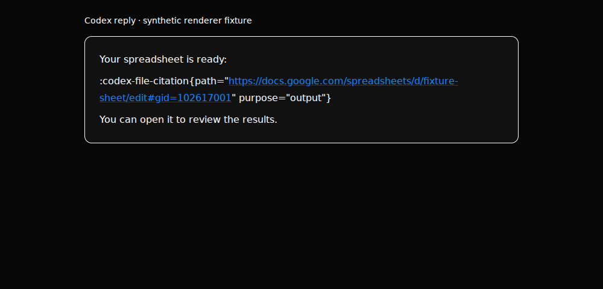
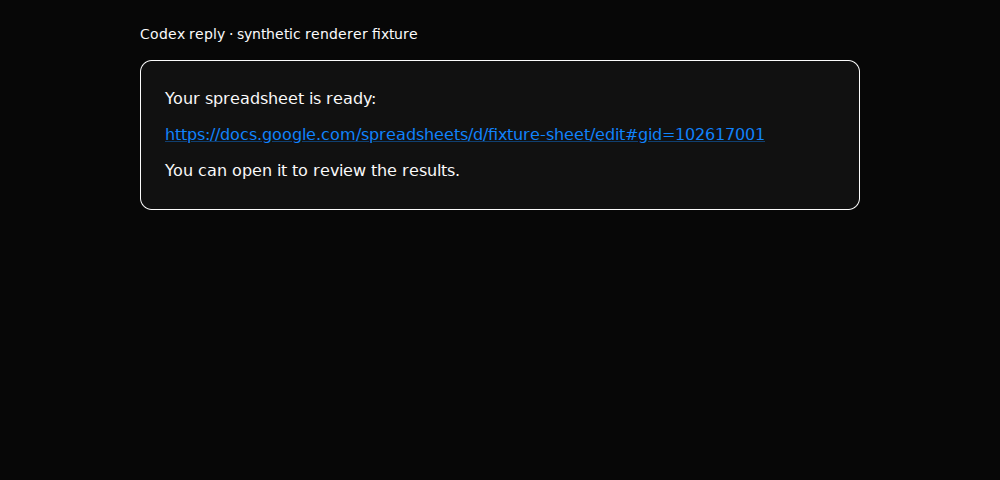

# Codex output links

Codex replies can contain `:codex-file-citation{path="..." purpose="output"}`.
The chat renderer turns complete HTTP(S) output citations into ordinary links,
including when the path itself is a Markdown link. The existing URL sanitizer,
external-link controls and hover card still apply. Query strings, fragments,
link labels and surrounding Markdown are preserved.

Code examples, escaped wrappers, incomplete citations, unknown attributes or
purposes, and local file citations retain their existing rendering. This is an
external-link rendering fix; it does not grant file access or rewrite persisted
messages. Image source offsets stay tied to the original message.

## Regression checks

```sh
pnpm exec vitest run src/components/ChatMarkdown.codex-citations.test.ts src/components/ChatMarkdown.test.ts src/components/ChatMarkdown.renderers.test.ts scripts/testing/file-size-ratchet.test.ts scripts/testing/verification-docs.test.ts
pnpm typecheck
pnpm lint
pnpm i18n:check
```

The regression suite covers the nested Markdown link shape, raw URLs, multiple
citations, punctuation consumed by GFM autolinks, lists/tables/emphasis, escaped
and code examples, unsupported/unsafe destinations, incomplete-to-complete
updates, and unchanged message-scoped image offsets.

## Isolated chat smoke test

Use the [chat UI fixture](chat-ui.md), with a synthetic reply file:

```sh
mkdir -p .omb-scratch
cat > .omb-scratch/citation-reply.txt <<'REPLY'
Your spreadsheet is ready:

:codex-file-citation{path="[Open spreadsheet](https://docs.google.com/spreadsheets/d/fixture-sheet/edit#gid=102617001)" purpose="output"}
REPLY
FAKE_CLAUDE_REPLY_FILE="$PWD/.omb-scratch/citation-reply.txt" node --experimental-strip-types scripts/control-omb.ts ui launch
```

In a second terminal, substitute the printed handle for `HANDLE`:

```sh
pnpm control:omb ui type --ui HANDLE --name "Message Pepper" --text "Show the fixture output link"
pnpm control:omb ui press --ui HANDLE --keys Enter
pnpm control:omb ui wait-settle --ui HANDLE --timeout 60
pnpm control:omb ui snapshot --ui HANDLE
```

Expect a link named **Open spreadsheet** in the reply and no visible citation
wrapper or `purpose` attribute. Inspect its destination without navigating: it
must retain `#gid=102617001`. Ctrl-C the launcher to remove its disposable home.
No real Codex account or document is needed.

## Recorded browser verification

An isolated renderer check mounted the real `ChatMarkdown` against a disposable
fake-engine server, compared with the component from upstream commit
`03a6e88bc13ad2c2fb5c16a80d1a0b732b88d588`. Chromium 153.0.8010.0 reproduced
the literal wrapper on that baseline and verified one exact destination link,
hidden metadata, keyboard focus, a fitting 390 px viewport and no page errors
with the fix. External network requests were blocked; the document was not opened.

This was automated component verification. The full chat recipe above and a
packaged desktop with a live Codex provider were not run for this change.

Before:



After:


