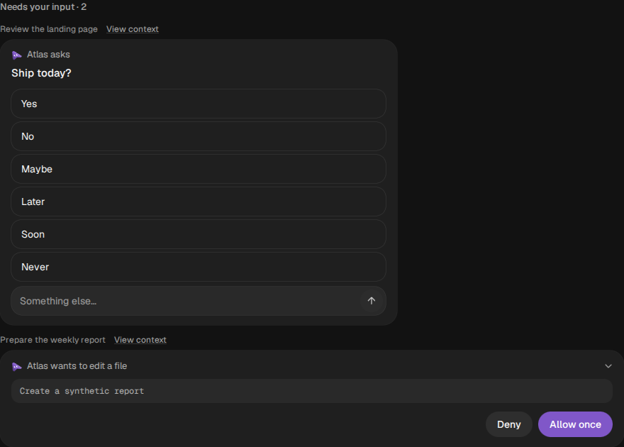

# Answer hidden-thread requests from the main chat

In Simple view (Show threads off), each bot's main chat shows **Needs your input**
cards from that bot's other conversations. The bot list shows the total number
of open requests, including requests in the current conversation. Each projected
card names its source task. Answering, denying, supplying a credential, signing
in or connecting an app uses that card's existing controls and original route.
**View context** is optional; **Back to main chat** returns from that conversation.

No opt-in, data migration or extra persisted copy is needed. Toggle Show threads
on to use the existing conversation UI instead. A card remains owned by its
source conversation and is reconstructed from that conversation's active history
after a reload or server restart. Answered, expired, cancelled, superseded,
auto-applied and already-relayed inbox cards are omitted. Archived conversations
are included if they still contain an actionable request. Pending work in group
chats is outside this bot-only projection.

The read-only `GET /api/input-requests` endpoint uses the current session's bot
and conversation visibility. Team Cloud additionally filters by the person
addressed. It is client-scoped, is not available to a bot's service scope, and
returns no tool outputs or attachment payloads. Existing answer authorization,
execution settings, exact-command review and credential storage remain in force.
An unavailable connection disables the projected controls. A failed refresh
shows an inline retry and disables stale cards; reconnect, foreground, card
updates and a 30-second revalidation recover the queue. A submission failure
keeps the original prompt actionable. Another window's answer removes it.

## Canonical UI map

| Capability | Canonical owner | Source of truth | Allowed variants | Verification |
|---|---|---|---|---|
| Form | QuestionCard, PendingApproval, SecretRequestCard, SignInRequestCard, ConnectorCard | Original source card and existing response routes | Transcript and main-chat projection | MainInputRequests.test.ts; isolated browser recipe below |

Visual ownership is documented in [DESIGN.md](../../DESIGN.md); no theme tokens
change for this feature. Permission and audience ownership comes from
[shared-workspace trust](shared-workspace-trust.md),
[shared-workspace governance](shared-workspace-governance.md), `server/visibility.ts`
and the existing response routes, rather than from this projection.

## Automated fixture

Run from a clean checkout with Node 24+, pnpm dependencies, Playwright and a
headless Chromium available:

```sh
OMB_VERIFY_BROWSER_CHROME=/absolute/path/to/chromium \
  node --experimental-strip-types scripts/testing/check-main-input.mjs
```

`OMB_VERIFY_PLAYWRIGHT` may point at a Playwright module. Optional
`OMB_VERIFY_BROWSER_ARGS` is a JSON array of Chromium launch arguments.
The runner owns its disposable server, data directory, synthetic CLI wrappers
and Vite preview, then closes them. It cannot target a live app URL. It uses the
repository's fake Codex app-server over stdio and makes no paid model calls.

It starts concurrent synthetic question and approval requests in two Atlas
subthreads, selects the main chat, verifies the count and both source cards,
reloads, sends a typed answer, injects a 503 on the approval submission, retries
with Deny, verifies the native provider receives the answer and denial on their
respective process connections, checks the queue empties without copied main
messages, and checks narrow-screen overflow. Screenshots and a JSON report go
to `.omb-scratch/verify-evidence/main-input/` (override with `OMB_INPUT_EVIDENCE`).
For interactive inspection, launch `node --experimental-strip-types
scripts/verify-main-input.ts` and open its printed preview URL; Ctrl-C cleans up.

## Manual packaged-app smoke test

Use a disposable workspace and simulated provider first. Keep Show threads off.

1. Open a bot's main chat with questions pending in two different tasks. Both
   source task titles, actual prompts and a bot-wide count should be visible.
2. Tab to a question, select or type an answer, and submit. Verify only that
   source task receives it; the main composer must not create a replacement turn.
3. Deny an approval. Confirm it resolves in the source conversation too. Repeat
   with a harmless permitted action to check the existing approval-policy controls.
4. Disconnect the renderer, then reconnect. Pending controls should disable while
   offline and recover. Answer from a second window; the first should remove it.
5. Reload and restart only this disposable server with an unresolved durable card.
   Verify the card reappears once. An engine's live approval may expire when its
   process exits; the projection does not promise to revive an interrupted engine.
6. Open View context, inspect the original card, and use Back to main chat. Toggle
   Show threads on and verify the normal conversation UI remains available.
7. Repeat in a light skin, with keyboard-only input, at phone width and with a
   long task title. Check credential and sign-in controls with synthetic data.

Automated tests cover durable Store reconstruction, thread-local deduplication,
private audiences, stale snapshots, session changes, failure recovery, concurrent
cards and original action routing. The browser fixture qualifies the web renderer
with a simulated provider. It does not qualify a packaged Electron build, live
provider connectivity, real credential entry or a production Team Cloud session.

## Verification recorded for this change

- 419 relevant tests across 12 files passed (new route/store/card tests plus
  existing approval, question, Simple sidebar, request-auth, Store and ratchets).
- Typecheck, lint, locale validation and the production build passed. The build
  retains CSS `::highlight` and dependency annotation warnings.
- Chromium 153 fixture checks passed for concurrent original cards, counts,
  source context/back navigation, reload, keyboard answer, failed approval retry,
  exact native provider decisions, no copied main messages and 390px layout.
  The rendered cards were inspected in Midnight and Daylight; reduced motion
  was enabled for the narrow layout check.
- Static strict audit of the new projection/store and modified approval controls
  found no violations. DESIGN.md lint found no errors or warnings; token values
  remain owned by the existing runtime stylesheet.
- Existing `Sidebar.simple-layout.test.ts` fails all 18 tests because its
  DesktopCapabilities mock lacks `windowFramed`. The same 18 failures were
  reproduced in a separate checkout of base `d26d7c164`; this feature does not
  change that mock or window chrome.
- The container's simulated native provider reported a shutdown warning; native
  process teardown is not qualified by this run. External Google favicon loads
  were blocked by the environment. The injected approval 503 is intentional.
  No JavaScript console errors or page exceptions occurred. Full-suite,
  packaged-app, live-provider and live Team Cloud verification were not run.


